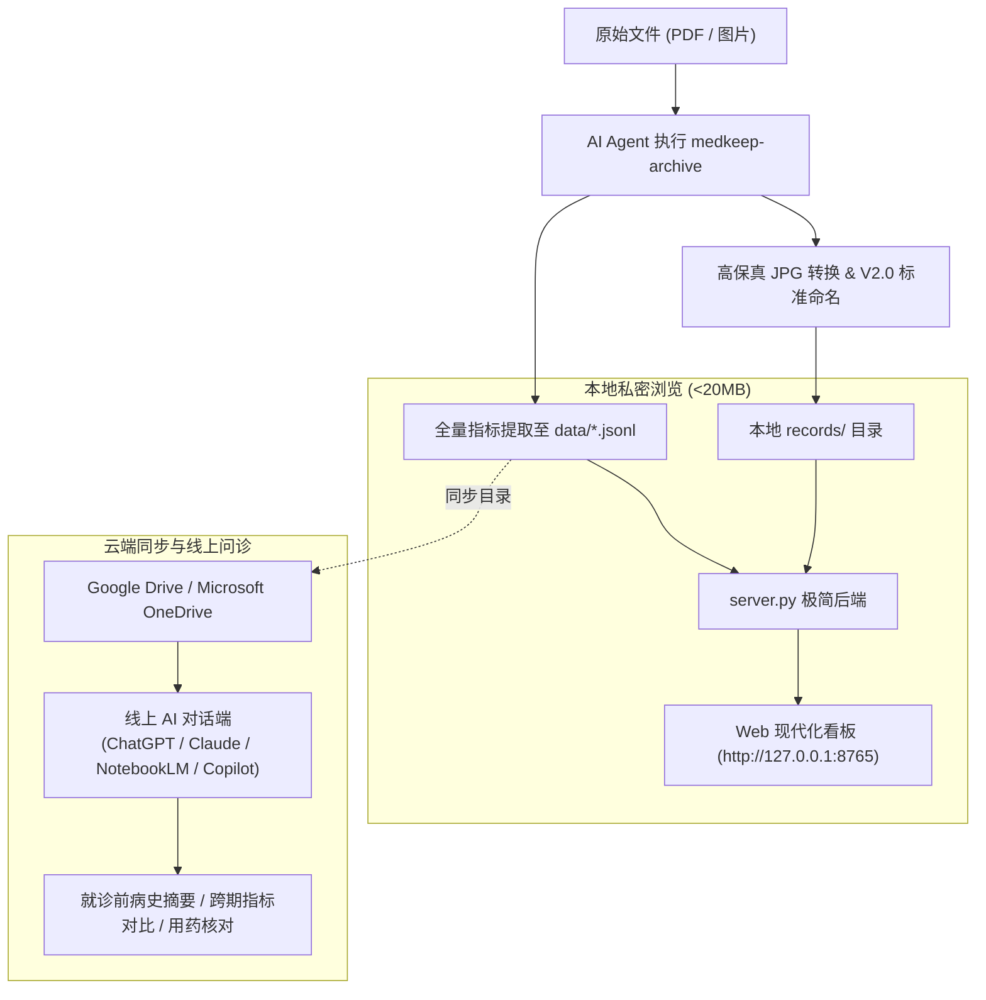
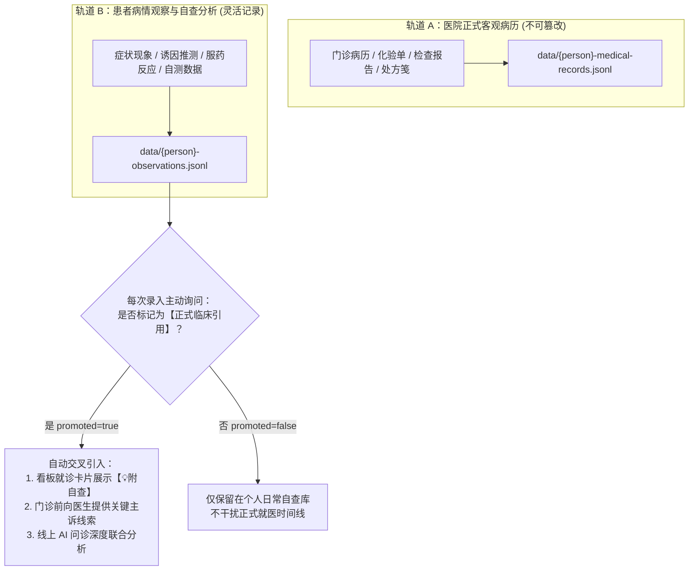

<div align="center">

**[简体中文](README.md)** · [English](README.en.md)

# MedKeep (medkeep)

**极简、AI Agent 原生驱动的家庭病历归档系统，支持云盘直连线上 AI 问诊**

无需安装庞大依赖，纯原生 Python 3 + Alpine.js 单页驱动；扔进病历照片或 PDF，AI 自动完成规范化重命名与结构化提取；一键同步 Google Drive / OneDrive，随时随地在线问诊。

[](LICENSE)
[](https://www.python.org/)
[](server.py)
[](server.py)
[](https://drive.google.com)
[](.agents/skills)

[快速开始](#快速开始) · [核心工作流](#核心工作流) · [云端同步与线上 AI 问诊](#云端同步与线上-ai-问诊) · [Skills 体系](#skills-体系) · [多成员与配置](#多成员与配置) · [常见问答](#常见问答)

</div>

---

## 快速开始

### 1. 环境准备
仅需安装 **Python 3.10 及以上版本**（后端采用纯原生标准库，**无需 `pip install` 任何第三方包**）：

- **macOS**：
  ```bash
  # 系统通常自带，或通过 Homebrew 安装
  brew install python3
  ```
- **Windows**：
  从 [python.org](https://www.python.org/downloads/) 下载并安装，安装时务必勾选 **"Add Python to PATH"**。

### 2. 获取项目
下载或克隆本项目文件夹至本地任意目录：
```bash
git clone https://github.com/your-username/medkeep.git
cd medkeep
```

### 3. 打开 Agent 并录入病历
使用您习惯的 AI Agent 工具（如 **Cursor**, **Claude Code**, **Codex**, **Antigravity**, **Windsurf** 等）打开本目录，直接向 Agent 发送指令并附带病历材料：

> **给 Agent 的提示词示例**：
> “桌面上新加了 3 张我昨天在医院就诊的病历和化验单，请按标准规范归档并更新病历库。”

Agent 将自动识别、规范重命名、转换为高保真 JPG、提取完整医疗指标至 JSONL 单一事实来源，并自动更新就诊闭环。

### 4. 启动本地可视化健康看板
在项目根目录运行单文件后端：
```bash
python3 server.py
```
终端输出：
```text
==================================================
  MedKeep 家庭病历与健康看板已启动
  访问地址: http://127.0.0.1:8765
  内存占用: < 20MB (纯原生 Python，零外部依赖)
==================================================
```
在浏览器中打开 `http://127.0.0.1:8765`，即可检视清晰优雅的家庭健康视图（卡片默认全部收起，整洁明了；右上角支持一键“全部展开 / 全部收起”）。

---

## 核心工作流



- **全流程自动化**：PDF 强制 2400px 无损转 JPG（自动删除易损坏的 PDF），按 `YYYYMMDD-{type}-{category}-pN.jpg` 四段式重命名。
- **单一事实来源（Single Source of Truth）**：以标准 JSONL 记录每一笔单据的就诊时间、医院科室、主诉、查体、全量指标（含参考范围与 ↑↓ 标示）、手写医嘱。
- **就诊闭环与病情收拢**：
  - **就诊事件流（Episodes）**：以门诊病历为锚点，智能关联跨天出具的检验报告与影像诊断。
  - **病情全景视图（Conditions）**：按同类专科或疾病（呼吸内科、消化内科、心血管科、健康体检等）跨周期纵向收拢。
- **默认全折叠设计**：打开页面整洁明了，支持一键“全部展开 / 全部收起”，按需精准查看。

---

## 双轨数据与自查分析打标机制

为了兼顾“医院客观诊断的严肃性”与“患者日常细致自查的灵活性”，MedKeep 采用 **双轨数据隔离与手动打标引用机制**：



### 1. 为什么必须双轨隔离？
- **医院客观单据（轨道 A）**：具备法律和临床严肃性，记录医生诊断、客观化验数值（如白细胞、C反应蛋白、血脂血糖）与官方处方。
- **个人自查分析（轨道 B）**：记录患者主观感受与生活触发点（如“降温吹风后夜间干咳”、“进食生冷后胃部隐痛”、“服药3天后症状明显缓解”）。
- **两库物理隔离**：绝不污染医院正式病历的结构化字段，互不干扰。

### 2. 手动打标确认机制 (Promote to Clinical Context)
每当您通过 Agent 记录一段自查推测或日常现象时，Agent 必须向您明确发起确认：
> 💡 *“已为您记录该条病情自查分析。请确认：**是否将此记录打标为【正式临床引用】？**”*
- **打标确认后（`promoted_to_clinical_context: true`）**：
  - Web 看板在对应日期的门诊事件卡片上，自动亮起 **`💡 附自查 N 条`** 徽章；
  - 点开卡片即可在医院化验单旁边并列看到您的自述现象与推测；
  - 导出或在线生成就医病史摘要时，AI 会将其作为**关键主诉与鉴别诊断线索**无缝引用！

---

## 云端同步与线上 AI 问诊

得益于 MedKeep 的 **纯文本结构化设计（JSONL / Markdown）**，您的全量健康数据体积极小且无二进制门槛，可天然接入各大主流云盘与在线 AI 对话平台。

### 1. 同步到云盘
直接将 `medkeep/` 项目目录（或仅将 `data/` 目录）放入云盘同步文件夹：
- **Google Drive**：放入本地 `Google Drive` 同步目录（例如：`~/Google Drive/我的云端硬盘/medkeep`）；
- **Microsoft OneDrive**：放入本地 `OneDrive` 文件夹中。

### 2. 在线 AI 对话端挂载与问诊

各平台操作指引如下：

| 在线平台 | 推荐连接方式 | 适用场景 |
| :--- | :--- | :--- |
| **ChatGPT Plus / Team** | 点击输入框旁边的 `+` ➡️ 选择 **Connect to Google Drive / OneDrive** ➡️ 选中 `{person}-medical-records.jsonl` | 随时提问近期用药、病史追溯、用药禁忌核对 |
| **Google NotebookLM** | 新建笔记本 ➡️ 来源选择 **Google Drive** ➡️ 勾选 `medkeep/data/` 对应文件 | 生成门诊病情述要、就诊问诊清单、深度指标比对 |
| **Microsoft Copilot** | 登录个人/工作账户 ➡️ 开启读取 OneDrive 权限直接提问 | 快速检索既往检查单结论与时间线 |
| **Claude.ai** | 直接将 `data/{person}-medical-records.jsonl` 作为附件上传对话 | 深度复杂病情梳理、多学科鉴别诊断参考 |

### 3. 实用问诊提示词（直接复制使用）

> [!TIP]
> **场景 1：看病前生成给医生的病史小结**
> *“我今天准备去医院复诊。请根据我附件中的病历记录，按时间倒序整理出我过去 1 年的历次就诊原因、核心异常化验指标及目前在用的药物方案，输出一份适合医生快速阅读的 300 字病史摘要。”*

> [!TIP]
> **场景 2：跨周期检验指标对比**
> *“请对比我最近两次年度体检与门诊复查的血常规、肝肾功能及血脂报告，列出各项核心指标的数值变化表，并分析各项指标的改善或波动趋势。”*

> [!TIP]
> **场景 3：突发用药安全性与禁忌核对**
> *“我今天感冒发热，准备服用某种解热镇痛药。请根据我档案中的当前在用药物与既往病史，帮我核对该药与我日常服用的慢病药物是否有配伍禁忌或不良反应风险？”*

---

## Skills 体系

项目内置 `.agents/skills/`，使任何支持 Skill 规范的 Agent 能够开箱即用：

| Skill 名称 | 适用场景 | 核心动作 |
| :--- | :--- | :--- |
| **`medkeep-intake`** | 用户提交新材料、初次建档、跨人录入 | 判定/询问归属人；维护家庭成员索引；保证 JSONL 原子写入。 |
| **`medkeep-archive`** | 格式规整、命名标准化、文件存储分发 | 统一 PDF 转换（2400px）；四段式规范重命名；分发至本地目录。 |
| **`medkeep-viewer`** | 可视化服务运维、事件闭环编排 | 自动聚类跨天报告与病情大类；管理与热重启 `server.py`。 |
| **`medkeep-doctor`** | 历史病历问答、用药核对、指标对比 | 基于 JSONL 事实库，快速对比跨周期指标（如血常规、肝肾功能、血压血脂趋势）。 |

---

## 多成员与配置

项目根目录的 `config/medkeep.json`（或模板 `config/medkeep.template.json`）控制系统配置：

```json
{
  "storage": {
    "mode": "local", 
    "local_records_dir": "./records"
  },
  "members": [
    {
      "id": "demo",
      "name": "示例成员",
      "gender": "男",
      "birth_year": 1990,
      "conditions": ["健康随访"]
    },
    {
      "id": "father",
      "name": "父亲",
      "gender": "男",
      "birth_year": 1962,
      "conditions": ["高血压"]
    }
  ]
}
```

### 多人录入交互防呆规则
若用户提交单据时未说明归属人，Agent 会先主动核实：
> “检测到您提交了新单据，请问该病历属于哪位家庭成员？（请参考 `config/medkeep.json` 中的成员列表；若是新成员，请提供英文 ID 与姓名，例如：`father` / `父亲`）”

---

## 目录结构

```text
medkeep/
├── .agents/
│   └── skills/                  # 内置 Agent Skills
│       ├── medkeep-intake/
│       ├── medkeep-archive/
│       ├── medkeep-viewer/
│       └── medkeep-doctor/
├── config/
│   ├── medkeep.json             # 本地私密配置 (已被 .gitignore 保护)
│   └── medkeep.template.json    # 开源配置样例 (开箱即用)
├── data/                        # 结构化数据单一事实来源
│   ├── {person}-medical-records.jsonl # 个人正式病历 (已被 .gitignore 保护)
│   ├── {person}-observations.jsonl    # 个人自查分析 (已被 .gitignore 保护)
│   ├── records.sample.jsonl     # 开源脱敏病历样例
│   └── observations.sample.jsonl # 开源脱敏自查分析样例
├── records/                     # 归档图片存储目录
│   ├── .gitkeep
│   ├── demo/                    # 开箱即用脱敏示例单据 (门诊病历与化验单)
│   └── {person}/                # [本地私密] 个人原件本地存储 (已被 .gitignore 保护)
├── viewer/                      # 现代化单页看板
│   └── index.html               # Tailwind CSS + Alpine.js 前端 (默认全部收起)
├── server.py                    # 极简纯原生 Python 3 后端 (<20MB)
├── AGENTS.md                    # Agent 行动总则与操作规约
└── README.md                    # 本文档
```

---

## 常见问答

#### Q1: 为什么 MedKeep 坚持所有病历图片全量存本地，而不是存远程云端或 NAS？
**答**：
1. **容量极小，绝无压力**：经过优化的高清医疗单据（2400px）每张约 500KB，一个家庭积累 10 年就医记录通常不超过 1GB，电脑硬盘毫无负担。
2. **纠错与维护极简**：远程存储极难删除、替换和重命名；而本地存储可以在文件管理器（Finder / 资源管理器）中自由重命名、拖入回收站或批量调整，无网络与鉴权摩擦。
3. **离线秒开与隐私安全**：本地访问零延迟，断网可用，医疗敏感原件绝不经过第三方服务器。
4. **无缝云端问诊**：直接将项目文件夹放在 Google Drive 或 OneDrive 中，既享受本地操作的极速，又自动享有云端备份与线上 AI 问诊能力。

#### Q2: 为什么一定要将 PDF 转成 JPG？
**答**：临床经验表明，各医院出具的电子病历 PDF 规格千奇百怪（经常出现内嵌特殊中文字体缺失、移动端预览渲染错位、图层重叠）。转为高分辨率 2400px JPG 后，排版永久固化，在任何终端秒开且绝对不会出现字体乱码或排版丢失。

#### Q3: 运行 `server.py` 提示端口 8765 被占用怎么办？
**答**：可直接指定端口启动：
```bash
python3 server.py --port 8888
```

#### Q4: 上传到 Google Drive / OneDrive 会泄露个人隐私吗？
**答**：本项目的所有数据都是您私有的本地文件，同步到您自己的个人云盘（Google / Microsoft），不经过任何第三方开发者服务器。在使用线上 AI（如 ChatGPT 或 Claude）分析时，数据仅在您授权的单次会话中处理。

---

## 许可证

[MIT License](LICENSE)
